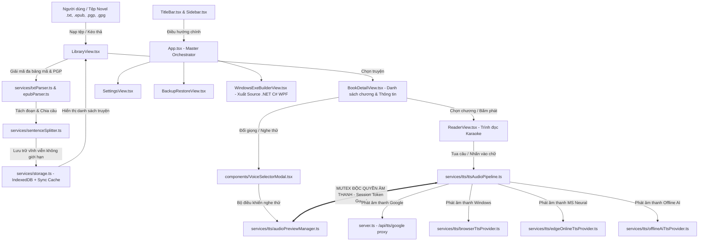

# SƠ ĐỒ KIẾN TRÚC & BẢN ĐỒ TỪNG TỆP DỰ ÁN STORYTTS DESKTOP
*(Architecture Map & System File Reference)*

Tài liệu này hệ thống hóa toàn bộ cấu trúc dự án StoryTTS, nhiệm vụ của từng tệp, sự liên kết giữa các module và cơ chế xử lý âm thanh/dữ liệu giúp việc bảo trì, phát triển và sửa lỗi diễn ra chính xác, nhanh chóng nhất.

---

## 1. Sơ Đồ Khối Tổng Thể (System Architecture Flowchart)

---

## 2. Bản Đồ Chi Tiết Từng Tệp (File-By-File Directory & Task Registry)

### Nhóm 1: Điều Phối & Giao Diện Cốt Lõi (Core Orchestration & UI)

| Tên Tệp | Tác Vụ Chính & Nhiệm Vụ | Nhận Dữ Liệu Từ (Imports) | Cung Cấp Cho (Used By) |
| :--- | :--- | :--- | :--- |
| **`src/App.tsx`** | Master Component. Quản lý trạng thái toàn cục (activeBook, chapters, queue, playback state, router view). | `storage.ts`, `ttsAudioPipeline.ts`, Tất cả các Views | `main.tsx` (Entry point) |
| **`src/components/TitleBar.tsx`** | Thanh tiêu đề chuẩn Windows 11 Fluent: thu nhỏ, phóng to, đóng, tên sách đang mở và nút Build EXE. | `lucide-react` | `App.tsx` |
| **`src/components/Sidebar.tsx`** | Thanh điều hướng chính bên trái (Thư viện, Sao lưu, Cài đặt, Build .EXE). Đã tối ưu bảng màu hiện đại. | `lucide-react` | `App.tsx` |
| **`src/components/LibraryView.tsx`** | Quản lý kho sách, tìm kiếm, lọc, kéo thả tệp (Drag & Drop), nạp tệp `.txt`, `.epub`, `.pgp`, `.gpg`. | `txtParser.ts`, `epubParser.ts`, `storage.ts`, `backupService.ts` | `App.tsx` |
| **`src/components/BookDetailView.tsx`** | Xem chi tiết truyện, danh sách các phần/chương, nút đổi giọng Google Tiếng Việt, nút phát ngay. | `types`, `lucide-react` | `App.tsx` |
| **`src/components/ReaderView.tsx`** | Trình đọc toàn màn hình, bôi vàng câu karaoke theo thời gian thực, nhấn câu để tua đọc ngay lập tức. | `types`, `storage.ts`, `lucide-react` | `App.tsx` |
| **`src/components/TtsControlsBar.tsx`** | Thanh dock phát âm thanh nổi ở đáy màn hình khi duyệt các trang khác, điều chỉnh tốc độ, dừng/phát. | `types`, `lucide-react` | `App.tsx` |
| **`src/components/VoiceSelectorModal.tsx`** | Hộp thoại chọn giọng Google Tiếng Việt, Microsoft, TikTok. Nút nghe thử không bị lặp hay chồng âm thanh. | `audioPreviewManager.ts`, `types` | `App.tsx`, `BookDetailView.tsx`, `ReaderView.tsx` |
| **`src/components/SettingsView.tsx`** | Cấu hình cỡ chữ, khoảng cách dòng, bộ máy giọng đọc mặc định, quản lý bộ nhớ đệm audio cache. | `storage.ts`, `types` | `App.tsx` |
| **`src/components/BackupRestoreView.tsx`**| Xuất tệp sao lưu `.storytts` (manifest, database) và phục hồi an toàn 100%. | `backupService.ts`, `storage.ts` | `App.tsx` |
| **`src/components/WindowsExeBuilderView.tsx`**| Trung tâm đóng gói và tải trọn gói mã nguồn C# .NET 8 WPF để biên dịch ra file `.EXE` chạy trên Windows. | `dotNetExporter.ts`, `jszip` | `App.tsx` |

---

### Nhóm 2: Xử Lý Âm Thanh & Cơ Chế Chống Trùng Âm (TTS & Audio Engine)

| Tên Tệp | Tác Vụ Chính & Nhiệm Vụ | Liên Kết & Vai Trò Trong Chuỗi Âm Thanh |
| :--- | :--- | :--- |
| **`src/services/tts/globalAudioGuard.ts`** | **Master Mutex toàn cục**: Quản lý tập hợp tất cả các thẻ `HTMLAudioElement` và Web Speech API. Bất kỳ khi nào có thao tác phát mới, hàm `stopEverything()` được kích hoạt để dập tắt triệt để mọi âm thanh cũ trong tab. | Kết nối với `ttsAudioPipeline.ts` và `audioPreviewManager.ts`. |
| **`src/services/tts/ttsAudioPipeline.ts`** | **Trái tim phát âm thanh**: Quản lý hàng đợi câu, State Machine, tải trước (prefetch), phát liên tục sang chương mới. **Sở hữu `activeSessionId` ngăn triệt để lỗi chồng âm thanh**. | Gọi các Providers (`GoogleTtsProvider`, `BrowserTtsProvider`, `EdgeOnlineTtsProvider`), liên kết với `AudioPreviewManager`. |
| **`src/services/tts/audioPreviewManager.ts`** | **Singleton điều khiển nghe thử**: Ngắt lập tức âm thanh cũ khi người dùng nhấn nghe thử liên tục nhiều lần. | Được gọi từ `VoiceSelectorModal.tsx`. Tự động dừng `ttsAudioPipeline` khi nghe thử. |
| **`src/services/tts/googleTtsProvider.ts`** | Kết nối giọng Google Tiếng Việt trực tuyến, phát âm chuẩn ngữ điệu và biểu cảm. | Gọi endpoint `/api/tts/google` của `server.ts`. |
| **`src/services/tts/browserTtsProvider.ts`** | Trích xuất các giọng đọc có sẵn trong hệ điều hành Windows SAPI / Browser TTS (độ trễ 0ms). | Tương tác trực tiếp với Web Speech API `window.speechSynthesis`. |
| **`src/services/tts/edgeOnlineTtsProvider.ts`** | Hỗ trợ các giọng Neural chất lượng cao của Microsoft (Nam Minh, Hoài My). | Cung cấp định dạng âm thanh đám mây MP3. |
| **`src/services/tts/offlineAiTtsProvider.ts`** | Giao diện mô hình AI Offline (Piper / ONNX VinaTTS) cho bản Windows Desktop. | Tích hợp trong giải pháp đóng gói .NET EXE. |

---

### Nhóm 3: Dữ Liệu, Giải Mã & Xử Lý Văn Bản (Data & Text Parser)

| Tên Tệp | Tác Vụ Chính & Nhiệm Vụ | Kỹ Thuật Độc Quyền |
| :--- | :--- | :--- |
| **`src/services/storage.ts`** | Lưu trữ toàn bộ dữ liệu truyện, chương, lịch sử, bookmark, settings. | **IndexedDB (`StoryTTS_IndexedDB_v2`)** kết hợp In-Memory Cache: lưu hàng trăm chương mà không bị lỗi giới hạn 5MB của localStorage. |
| **`src/services/txtParser.ts`** | Nạp tệp novel, nhận diện mẫu chương tiếng Việt (`Chương \d+`, `Hồi \d+`...), tách phần tự động. | Hỗ trợ UTF-8 BOM, UTF-16LE, Windows-1258, và giải mã **OpenPGP / GPG** có mật mã hoặc chữ ký rõ. |
| **`src/services/epubParser.ts`** | Giải nén gói EPUB / ZIP, đọc file OPF metadata, spine, TOC và trích xuất nội dung chương. | Sử dụng thư viện `JSZip` client-side. |
| **`src/services/sentenceSplitter.ts`**| Bộ tách câu thông minh tiếng Việt: xử lý dấu hội thoại ngoặc kép, kính ngữ, số thập phân để không ngắt vụn câu. | Được gọi bởi `txtParser.ts` và `chunker.ts`. |
| **`src/services/chunker.ts`** | Gom các câu thành các đoạn chunk tối ưu (~240 ký tự) để gửi đến bộ máy TTS phát mượt mà nhất. | Chuẩn bị queue cho `ttsAudioPipeline.ts`. |
| **`src/services/backupService.ts`** | Xuất/nhập file sao lưu toàn diện và xuất sách thành file văn bản TXT. | Kết nối với `storage.ts`. |
| **`src/services/dotNetExporter.ts`** | Sinh toàn bộ Solution Visual Studio C# .NET 8 (WPF + WebView2 + SQLite) thành file ZIP 1-click tải về. | Dành cho việc biên dịch ra file `.EXE` độc lập trên Windows. |

---

### Nhóm 4: Máy Chủ & Proxy Âm Thanh (Backend Server)

| Tên Tệp | Tác Vụ Chính & Nhiệm Vụ |
| :--- | :--- |
| **`server.ts`** | Khởi chạy Express server + Vite middleware dev mode (Port 3000). Cung cấp endpoint proxy `/api/tts/google` để tải luồng audio Google Tiếng Việt mà không bị chặn bởi CORS trình duyệt. |

---

## 3. Cơ Chế Chống Chồng Âm Thanh Triệt Để (Single Audio Mutex Rule)

1. **Khóa Định Danh Phiên (`activeSessionId`)**:
   - Mỗi lần người dùng nhấn **Phát**, **Dừng**, **Chuyển chương**, hoặc **Nhấn vào chữ để tua**, `activeSessionId` tự động tăng lên 1 đơn vị.
   - Bất kỳ vòng lặp audio cũ nào đang trong trạng thái chờ mạng hoặc vừa phát xong sẽ bị so sánh `session !== this.activeSessionId` và **bị loại bỏ ngay lập tức**, không thể kích hoạt chunk tiếp theo.
2. **Hủy Sự Kiện Trước Khi Ngắt (`Detach Listeners First`)**:
   - Trước khi gọi `audio.pause()`, hệ thống lập tức gán `audio.onended = null`, `audio.onerror = null`. Điều này loại bỏ hoàn toàn hiện tượng trình duyệt bắn sự kiện lỗi giả khi ngắt stream và tự động chạy fallback sang SpeechSynthesis gây lồng tiếng.
3. **Độc Quyền Giữa Trình Đọc và Nghe Thử**:
   - `AudioPreviewManager` và `TtsAudioPipeline` liên kết chéo: Khi một bên phát, bên kia bị buộc dừng ngay lập tức.
   - **Cam kết**: Trong toàn bộ ứng dụng, tại một thời điểm chỉ có duy nhất **01 luồng âm thanh** được phép phát.
