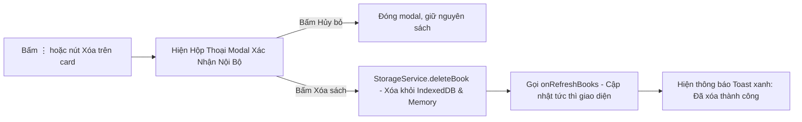

# TÀI LIỆU HƯỚNG DẪN MODULE THƯ VIỆN & QUẢN LÝ SÁCH
*(Library Module Reference — `src/components/LibraryView.tsx`)*

Tài liệu này tóm tắt ngắn gọn các tính năng cốt lõi của màn hình Thư Viện để bạn dễ dàng nắm bắt toàn bộ luồng mà không cần đọc mã nguồn.

---

## 1. Danh Sách Tính Năng Mới Đã Triển Khai

| Tính Năng | Trạng Thái | Mô Tả Hoạt Động |
| :--- | :--- | :--- |
| **Xóa Sách (In-App Confirm)** | ✅ Đã hoạt động dứt điểm | Thay thế `window.confirm` (vốn bị trình duyệt iframe chặn) bằng **hộp thoại xác nhận nội bộ (In-App Modal)**. Khi bấm "Xóa sách", hộp thoại cảnh báo xuất hiện với 2 nút [Hủy bỏ] và [Xóa sách] (màu đỏ). Xóa sạch dữ liệu trong IndexedDB và bộ nhớ máy. |
| **Sắp Xếp Theo (Sort Sheet)** | ✅ Đã hoạt động | Nhấp vào icon phễu lọc bên cạnh thanh tìm kiếm sẽ mở cửa sổ trượt phía dưới với 4 tiêu chí sắp xếp: **Mới nhất**, **Đọc gần đây**, **Lượt nghe nhiều nhất**, **Số lượng chương** có dấu tích xanh `✓`. |
| **Chế Độ Xem (List vs Grid)** | ✅ Đã hoạt động | Nút chuyển đổi giao diện: bấm để luân chuyển giữa **Chế độ Danh Sách (List)** (dòng ngang có nút Play xanh và menu ⋮) và **Chế độ Lưới (Grid)** (các bìa sách đứng 3:4, tiêu đề và dòng chữ xanh `Chương X: (2)` giống hệt ảnh mẫu). |
| **Nạp Tệp Đa Định Dạng** | ✅ Đã hoạt động | Hỗ trợ kéo thả hoặc chọn tệp `.txt`, `.epub`, `.pgp`, `.gpg`, `.zip`. Giải mã không giới hạn dung lượng vào IndexedDB. |

---

## 2. Chi Tiết Các Tiêu Chí Sắp Xếp (Sort Options)

1. **Mới nhất (`newest`)**:
   - Ưu tiên tác phẩm vừa được nạp vào thư viện gần đây nhất (`createdAt` / `updatedAt`).
2. **Đọc gần đây (`recent`)**:
   - Xếp những bộ truyện người dùng vừa nghe/đọc lên đầu (`lastReadTime`).
3. **Lượt nghe nhiều nhất (`most-listened`)**:
   - Sắp xếp giảm dần theo tổng số lần nghe (`listenCount`).
4. **Số lượng chương (`chapters-count`)**:
   - Đưa các bộ tiểu thuyết trường thiên có số lượng chương lớn nhất lên đầu (`totalChapters`).

---

## 3. Chế Độ Hiển Thị (View Modes)

- **Chế độ Danh Sách (`list`)**:
  - Thích hợp xem nhanh thông tin tệp, số chương, tác giả, tag `VI-VN`.
  - Có nút tròn màu xanh lá để phát nhanh chương đang nghe dở.
  - Có nút ba chấm `⋮` để xuất file TXT hoặc mở hộp thoại xóa sách.
- **Chế độ Lưới (`grid`)**:
  - Giao diện trực quan dạng giá sách, hiển thị bìa truyện tỉ lệ 3:4.
  - Dòng trạng thái `Chương X: ...` hiển thị chữ màu xanh ngọc (Emerald Green).
  - Nhấp vào bất kỳ bìa truyện nào sẽ mở trực tiếp trang Mục lục & Chi tiết chương.

---

## 4. Cơ Chế Xóa Sách An Toàn

