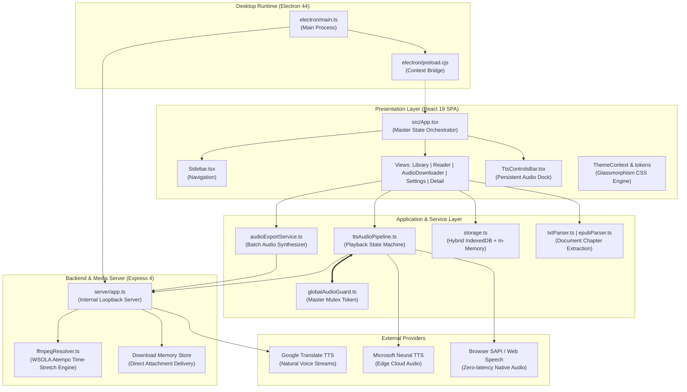

# Kiến Trúc Hệ Thống Tổng Thể — Lbook

> **Mục tiêu**: Mô tả cấu trúc các lớp phần mềm, luồng giao tiếp giữa các thành phần và ranh giới module của ứng dụng Lbook.

---

## 1. Cấu trúc thư mục dự án thực tế

```text
lbook/
├── electron/                 # Mã nguồn Electron Desktop (Main Process & Preload)
│   ├── main.ts               # Khởi tạo cửa sổ, vòng đời, máy chủ cục bộ 127.0.0.1
│   └── preload.cjs           # Bridge IPC an toàn (contextIsolation: true)
├── server/                   # Backend Express & Dịch vụ xử lý âm thanh
│   ├── app.ts                # Định nghĩa Express API, proxy Google TTS, download store
│   └── ffmpegResolver.ts     # Tự động tìm nạp binary FFmpeg trên Windows & Linux
├── src/                      # Frontend Single Page Application (React 19 + TypeScript)
│   ├── components/           # Giao diện người dùng (Views, Modals, Docks)
│   │   ├── ui/               # Thành phần giao diện nguyên tử (Button, Card, Modal)
│   │   ├── AudioDownloaderView.tsx  # Trang tải và xuất âm thanh MP3/ZIP
│   │   ├── ReaderView.tsx           # Trình đọc truyện & highlight âm thanh realtime
│   │   ├── LibraryView.tsx          # Quản lý kho truyện, nạp TXT/EPUB/PGP
│   │   ├── BookDetailView.tsx       # Chi tiết tác phẩm & danh sách chương
│   │   ├── SettingsView.tsx         # Cài đặt giao diện, giọng đọc, dọn dẹp thư viện
│   │   └── Sidebar.tsx              # Thanh điều hướng chính bên trái
│   ├── design-system/        # Quản lý Theme, glassmorphism tokens, backgrounds
│   ├── i18n/                 # Đa ngôn ngữ tiếng Việt (vi.ts) & tiếng Anh (en.ts)
│   ├── services/             # Nghiệp vụ: lưu trữ, bóc tách tài liệu, pipeline TTS
│   │   ├── tts/              # Pipeline âm thanh, Master Mutex, các nhà cung cấp giọng
│   │   ├── storage.ts        # Lưu trữ IndexedDB + đồng bộ LocalStorage
│   │   ├── audioExportService.ts    # Xuất âm thanh hàng loạt và nén ZIP
│   │   ├── txtParser.ts             # Giải mã TXT & nhận diện chương tiếng Việt
│   │   └── epubParser.ts            # Giải nén cấu trúc file sách EPUB
│   ├── types/                # Định nghĩa TypeScript Domain Models
│   ├── App.tsx               # Orchestrator điều phối trạng thái toàn cục
│   ├── index.css             # Tailwind CSS v4 & Biến CSS Glassmorphism
│   └── main.tsx              # Entry point gắn kết React vào DOM
├── scripts/                  # Scripts build, đóng gói Electron và kiểm tra tài liệu
│   ├── build-electron.mjs    # Biên dịch TypeScript cho Electron sang CommonJS
│   └── check-docs.mjs        # Kiểm tra tự động giới hạn 300 dòng và liên kết docs
├── electron-builder.json     # Cấu hình đóng gói NSIS installer và portable ZIP
├── server.ts                 # Entry point khởi chạy máy chủ kết hợp Vite middleware
└── package.json              # Khai báo dependencies và scripts quản lý
```

---

## 2. Sơ đồ kiến trúc tổng thể (System Layers)



---

## 3. Ranh giới trách nhiệm giữa các tầng (Layer Boundaries)

1. **Giao diện (Frontend)**: Chịu trách nhiệm hiển thị giao diện kính mờ mượt mà, phản hồi chuyển đổi theme sáng/tối tức thì, và theo dõi tiến độ đọc câu (karaoke highlight). Frontend giao tiếp với backend thông qua các API REST tiêu chuẩn (`/api/*`), không phụ thuộc vào các module Node.js nguyên bản.
2. **Dịch vụ nghiệp vụ (Services)**: Quản lý hàng đợi âm thanh, thuật toán tách câu tiếng Việt, phát hiện chương bằng biểu thức chính quy, và lưu trữ dữ liệu bền vững vào IndexedDB.
3. **Backend & Xử lý âm thanh (Server)**: Cung cấp API proxy để vượt rào cản CORS của trình duyệt, áp dụng bộ lọc tăng/giảm tốc độ âm thanh chuẩn bằng thuật toán WSOLA của FFmpeg, và tạo file tải về trực tiếp.
4. **Vỏ bọc máy tính (Electron)**: Đóng gói toàn bộ ứng dụng thành file `.exe` độc lập, khởi tạo máy chủ nội bộ trên giao tiếp loopback `127.0.0.1`, và điều khiển kích thước cửa sổ.

---

## 4. Liên kết tới các tài liệu kiến trúc chuyên sâu

Để tìm hiểu chi tiết từng mảng kỹ thuật cụ thể, hãy tham khảo các tài liệu chuyên đề:

- [`docs/architecture/FRONTEND.md`](./architecture/FRONTEND.md): Kiến trúc giao diện, hệ thống token CSS glassmorphism và state machine điều hướng.
- [`docs/architecture/BACKEND.md`](./architecture/BACKEND.md): Cấu trúc máy chủ Express, proxy âm thanh, xử lý FFmpeg và streaming.
- [`docs/architecture/ELECTRON_DESKTOP.md`](./architecture/ELECTRON_DESKTOP.md): Vòng đời Electron, bảo mật IPC và quy trình build Windows Installer/Portable.
- [`docs/architecture/DATA_FLOW.md`](./architecture/DATA_FLOW.md): Sơ đồ luồng dữ liệu nạp sách, phát âm thanh, đồng bộ tiến độ và xuất MP3/ZIP.
