# BẢN ĐỒ TÁC VỤ & LIÊN KẾT TỪNG TỆP TRONG STORYTTS
*(StoryTTS Comprehensive File-by-File Mission & Linkage Registry)*

> **Mục đích tài liệu**: Tài liệu này đóng vai trò như một bản đồ tham chiếu nhanh cho từng tệp trong toàn bộ dự án. Khi gặp lỗi hoặc cần nâng cấp bất kỳ tính năng nào, chỉ cần tra cứu file tương ứng trong tài liệu này mà không cần đọc lại toàn bộ mã nguồn của dự án.

---

## 1. SƠ ĐỒ LIÊN KẾT TỔNG THỂ (Component Dependency Graph)

```mermaid
graph TD
    App[src/App.tsx - Master Orchestrator] --> TitleBar[components/TitleBar.tsx]
    App --> Sidebar[components/Sidebar.tsx]
    App --> Library[components/LibraryView.tsx]
    App --> BookDetail[components/BookDetailView.tsx]
    App --> Reader[components/ReaderView.tsx]
    App --> ControlsBar[components/TtsControlsBar.tsx]
    App --> VoiceModal[components/VoiceSelectorModal.tsx]
    App --> Settings[components/SettingsView.tsx]
    App --> Backup[components/BackupRestoreView.tsx]
    App --> ExeBuilder[components/WindowsExeBuilderView.tsx]

    %% TTS & Mutex Subsystem
    App --> Pipeline[services/tts/ttsAudioPipeline.ts]
    Pipeline <==> AudioGuard[services/tts/globalAudioGuard.ts - MASTER MUTEX]
    VoiceModal --> PreviewMgr[services/tts/audioPreviewManager.ts]
    PreviewMgr <==> AudioGuard

    Pipeline --> GoogleProv[services/tts/googleTtsProvider.ts]
    Pipeline --> EdgeProv[services/tts/edgeOnlineTtsProvider.ts]
    Pipeline --> BrowserProv[services/tts/browserTtsProvider.ts]
    Pipeline --> OfflineProv[services/tts/offlineAiTtsProvider.ts]
    GoogleProv --> ServerProxy[server.ts - /api/tts/google]

    %% Data & Parser Subsystem
    Library --> TxtParser[services/txtParser.ts]
    Library --> EpubParser[services/epubParser.ts]
    TxtParser --> Splitter[services/sentenceSplitter.ts]
    App --> Chunker[services/chunker.ts]
    Chunker --> Splitter
    AllViews[...] --> Storage[services/storage.ts - IndexedDB + Sync Cache]
```

---

## 2. BẢNG CHI TIẾT TỪNG TỆP & TÁC VỤ (File Registry)

### Nhóm 1: Giao Diện Người Dùng (Components)

| Tên Tệp | Tác Vụ Chính & Trách Nhiệm | Liên Kết Đầu Vào (Inputs) | Liên Kết Đầu Ra (Outputs / Handlers) |
| :--- | :--- | :--- | :--- |
| **`src/components/TitleBar.tsx`** | Thanh tiêu đề chuẩn Windows 11 Mica / Fluent. Thu nhỏ, phóng to, thoát app, hiển thị tên sách đang mở và nút 1-click Build EXE. | `activeBook`, `activeChapter`, `activeViewTitle` | `onBuildExeClick` |
| **`src/components/Sidebar.tsx`** | Thanh điều hướng bên trái (Thư viện, Sao lưu, Cài đặt, Build EXE). Hiển thị số lượng sách và sách đang nghe. | `currentView`, `hasActiveBook`, `totalBooksCount` | `onSelectView(view)` |
| **`src/components/LibraryView.tsx`** | Quản lý kho sách. Hỗ trợ:  1. **Bộ lọc & Sắp xếp**: Mới thêm, Đọc gần đây, Tên A-Z, Số chương, Lượt nghe, Đảo chiều tăng/giảm. 2. **Chế độ xem**: Danh sách (List), Lưới bìa sách (Grid), Rút gọn (Compact). 3. **Nạp sách**: Kéo thả tệp, nạp `.txt`, `.epub`, `.pgp`, `.gpg`, `.zip`. 4. **Xóa sách**: Modal xác nhận độc lập, cô lập sự kiện `stopPropagation` ngăn lỗi nhảy trang. | `books` | `onOpenBook(id)`, `onQuickPlay(id)`, `onDeleteBook(id)`, `onRefreshBooks()` |
| **`src/components/BookDetailView.tsx`** | Màn hình xem chi tiết tác phẩm & danh sách chương. Hỗ trợ:  1. Sắp xếp chương: Xuôi (1 ➔ N) hoặc Ngược (N ➔ 1). 2. Nút đổi giọng đọc nhanh Google Tiếng Việt. 3. Nút xóa tác phẩm và nút xuất tệp `.txt`. | `book`, `chapters`, `currentChapterId` | `onBackToLibrary`, `onSelectChapter(id)`, `onQuickPlay(id)`, `onDeleteBook(id)`, `onOpenVoiceSelector` |
| **`src/components/ReaderView.tsx`** | Trình đọc truyện toàn màn hình theo thời gian thực (Karaoke).  1. Nhấp vào chữ/câu để tua ngay lập tức không bị lặp âm thanh. 2. Áp dụng bảng màu nền (Sepia, Light, Dark, Black OLED, Mint, Sunset). 3. Thanh điều khiển âm thanh nổi ở chân trang: Tua câu, chuyển chương, hẹn giờ tắt, chọn giọng đọc nhanh. | `book`, `chapters`, `currentChapterId`, `activeParagraphIndex`, `activeSentenceIndex`, `isPlaying`, `settings` | `onJumpToPosition(para, sent)`, `onPlay`, `onPause`, `onNextSentence`, `onPreviousSentence`, `onUpdateSettings` |
| **`src/components/SettingsView.tsx`** | Trung tâm tùy biến giao diện và tham số hệ thống. Gồm 4 tab: 1. **Giao diện đọc**: Chọn màu nền, phông chữ (Be Vietnam, Serif, Sans, Playfair, Mono), cỡ chữ slider, khoảng cách dòng, căn lề 2 bên/trái, kiểu bôi màu karaoke, **Hộp xem trước trực tiếp (Live Preview)**. 2. **Chủ đề ứng dụng**: Fluent Dark, Fluent Light, Midnight Emerald, Warm Amber. 3. **Giọng đọc**: Chọn Google TTS, Microsoft Neural, tốc độ, cao độ. 4. **Bộ nhớ đệm**: Xem tỷ lệ hit rate và xóa cache audio. | `settings`, `voices`, `cacheStats` | `onUpdateSettings(partial)`, `onClearAudioCache()` |
| **`src/components/TtsControlsBar.tsx`** | Thanh phát âm thanh dock cố định ở đáy màn hình khi duyệt các trang khác (khi không ở trang ReaderView). | Trạng thái phát, chunk hiện tại, tiến độ | `onPlay`, `onPause`, `onStop`, `onRateChange`, `onSeekChunk` |
| **`src/components/VoiceSelectorModal.tsx`** | Hộp thoại chọn giọng nói tiếng Việt chuyên sâu (Google Tiếng Việt, Microsoft Nam Minh/Hoài My, TikTok MC). Có nút nghe thử giọng với cơ chế ngắt âm thanh cũ tức thì. | `isOpen`, `activeProviderId`, `activeVoiceId`, `systemVoices` | `onClose`, `onSelectVoice(provider, voice)` |
| **`src/components/BackupRestoreView.tsx`** | Xuất/nhập file sao lưu toàn diện định dạng JSON `.storytts`. | `StorageService` | `onDataRestored()` |
| **`src/components/WindowsExeBuilderView.tsx`** | Xuất trọn bộ mã nguồn C# .NET 8 WPF để biên dịch file `.EXE` chạy độc lập trên Windows. | `dotNetExporter.ts` | Tải file ZIP |

---

### Nhóm 2: Dịch Vụ Xử Lý Âm Thanh & Cơ Chế Chống Trùng Âm (Audio Subsystem)

| Tên Tệp | Tác Vụ Chính & Nhiệm Vụ | Cơ Chế Bảo Vệ Độc Quyền |
| :--- | :--- | :--- |
| **`src/services/tts/globalAudioGuard.ts`** | **Master Mutex cho toàn bộ ứng dụng**. Theo dõi toàn bộ các phần tử `HTMLAudioElement` và hàng đợi `window.speechSynthesis`. | Hàm `stopEverything()` lập tức dừng mọi âm thanh đang phát trên toàn app, hủy src, xả bộ đệm, tăng epoch token để hủy mọi tiến trình async đang chạy dở. |
| **`src/services/tts/ttsAudioPipeline.ts`** | **Trái tim phát âm thanh của truyện**. Chia hàng đợi chunks, prefetch câu tiếp theo, phát nối chương tự động, tua câu khi người dùng nhấp vào văn bản. | Sở hữu `activeSessionId`. Khi người dùng nhấp vào một câu mới để tua ("túa đến đó"), session tăng lên 1, gọi `GlobalAudioGuard.stopEverything()`, hủy ngay lập tức chunk cũ và chỉ phát duy nhất câu mới. |
| **`src/services/tts/audioPreviewManager.ts`** | **Quản lý nghe thử giọng đọc**. Đảm bảo khi người dùng nhấp nghe thử liên tục nhiều lần thì câu trước lập tức tắt ngúm và phát lại từ đầu mà không bao giờ bị nói đè. | Tích hợp trực tiếp với `GlobalAudioGuard`. |
| **`src/services/tts/googleTtsProvider.ts`** | Kết nối trực tuyến Google Tiếng Việt (chuẩn tự nhiên, biểu cảm). | Gọi proxy `/api/tts/google` của `server.ts`. |
| **`src/services/tts/edgeOnlineTtsProvider.ts`** | Kết nối giọng đọc Microsoft Neural (Nam Minh, Hoài My). | Trả về stream audio MP3. |
| **`src/services/tts/browserTtsProvider.ts`** | Giọng đọc Windows SAPI có sẵn trên máy tính người dùng (độ trễ 0ms). | Tương tác Web Speech API. |

---

### Nhóm 3: Dữ Liệu, Giải Mã & Phân Tích Văn Bản (Data & Parsing)

| Tên Tệp | Tác Vụ Chính & Nhiệm Vụ | Kỹ Thuật Độc Quyền |
| :--- | :--- | :--- |
| **`src/services/storage.ts`** | Quản lý lưu trữ truyện, danh sách chương, bookmarks, tiến độ đọc, cài đặt người dùng. | **IndexedDB (`StoryTTS_IndexedDB_v2`)** kết hợp In-Memory Cache: Lưu trữ không giới hạn dung lượng, không bao giờ bị lỗi đầy 5MB của localStorage. |
| **`src/services/txtParser.ts`** | Giải mã tệp `.txt`, nhận diện mẫu chương tiếng Việt tự động, phân tích câu. | Hỗ trợ giải mã **OpenPGP / GPG** (có passphrase hoặc file văn bản ký rõ), tự động nhận diện UTF-8, UTF-16, Windows-1258. |
| **`src/services/epubParser.ts`** | Giải nén và đọc cấu trúc tệp `.epub` trích xuất chương và ảnh bìa. | Sử dụng `JSZip` client-side. |
| **`src/services/sentenceSplitter.ts`**| Tách câu tiếng Việt thông minh, giữ nguyên dấu ngoặc kép hội thoại và số thập phân. | Chuẩn bị dữ liệu cho Chunking. |
| **`src/services/chunker.ts`** | Gom các câu thành các chunk âm thanh tối ưu (~240 ký tự) cho TTS. | Hỗ trợ từ điển thay thế cách phát âm. |

---

## 3. NGUYÊN TẮC GIẢI QUYẾT CÁC LỖI THƯỜNG GẶP (Quick Troubleshooting Guide)

### Lỗi 1: Âm thanh bị chồng lên nhau hoặc nhấp tua câu bị phát 2 - 3 tiếng cùng lúc
- **Nguyên nhân**: Một `HTMLAudioElement` cũ chưa bị `pause()` hoặc Web Speech API chưa bị `cancel()` trước khi audio mới bắt đầu.
- **Cách xử lý**: Gọi `GlobalAudioGuard.getInstance().stopEverything()` ngay trước khi bắt đầu bất kỳ âm thanh nào. `ttsAudioPipeline.ts` đã kiểm tra `session !== this.activeSessionId` ở mọi bước async.

### Lỗi 2: Xóa sách không hoạt động
- **Nguyên nhân**: Sự kiện `onClick` của nút xóa hoặc menu 3 chấm bị lan truyền (bubble) lên thẻ cha dẫn đến việc ứng dụng mở trang chi tiết truyện thay vì xóa.
- **Cách xử lý**: Luôn dùng `e.stopPropagation()` tại mọi nút thao tác con trong `LibraryView.tsx` và gọi `onDeleteBook(bookId)` để đồng bộ trạng thái toàn cục trong `App.tsx`.

### Lỗi 3: Không thấy nút chuyển chế độ xem hoặc sắp xếp
- **Nguyên nhân**: Bị ẩn trong modal hoặc thanh điều khiển thiếu nút chuyển đổi trực quan.
- **Cách xử lý**: `LibraryView.tsx` đã cung cấp thanh công cụ với nút chuyển đổi trực tiếp: **Danh sách (List)**, **Lưới (Grid)**, **Rút gọn (Compact)** và menu chọn chiều sắp xếp Tăng/Giảm.
