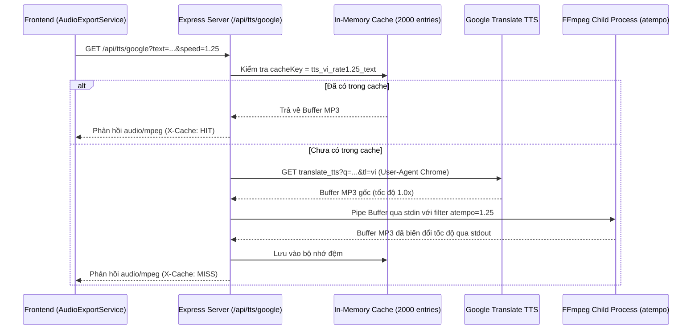

# Kiến Trúc Backend & Máy Chủ Xử Lý Âm Thanh — Lbook

> **Phạm vi**: Cấu trúc máy chủ Express 4 (`server/app.ts`, `server.ts`), giải pháp tích hợp FFmpeg (`server/ffmpegResolver.ts`), streaming âm thanh và cơ chế xuất file tải xuống cho Windows Desktop.

---

## 1. Vai trò của Backend trong Lbook

Lbook là một ứng dụng lai (Desktop / Web). Mặc dù giao diện là React SPA chạy trên client, ứng dụng vẫn sở hữu một backend Node.js gọn nhẹ chạy cục bộ (`127.0.0.1`) nhằm phục vụ các nhiệm vụ mà môi trường web thuần túy không thể thực hiện:

1. **Proxy Google TTS**: Vượt qua rào cản CORS của trình duyệt và giả lập User-Agent hợp lệ để lấy stream audio tự nhiên.
2. **Bộ xử lý tốc độ âm thanh chuẩn (FFmpeg WSOLA)**: Khi người dùng đổi tốc độ đọc (ví dụ `1.25x`, `1.50x`), Google TTS chỉ trả về file gốc 1.0x. Backend sử dụng bộ lọc `atempo` của FFmpeg để tăng/giảm tốc độ mà **không làm biến dạng cao độ giọng đọc** (pitch-preserving time-stretching).
3. **Stitching & Xuất file MP3**: Nối hàng chục đoạn audio nhỏ của một chương thành một file MP3 128k CBR 44.1kHz hoàn chỉnh với header thời lượng chuẩn xác.
4. **Download Store cho Windows**: Lưu trữ tạm thời các file ZIP hoặc MP3 dung lượng lớn trong RAM và cung cấp endpoint có header `Content-Disposition: attachment` để Windows tự động mở hộp thoại lưu file.

---

## 2. Danh mục API Endpoints (`server/app.ts`)

| Phương thức | Đường dẫn API | Mục đích & Trách nhiệm | Định dạng phản hồi |
| :--- | :--- | :--- | :--- |
| `GET` | `/api/health` | Kiểm tra tình trạng server, đường dẫn FFmpeg và timestamp | JSON `{ status, ffmpegPath, timestamp }` |
| `GET` | `/api/tts/google` | Lấy stream âm thanh đọc câu với tham số `text`, `lang`, `speed` | Stream `audio/mpeg` (Header `X-Cache: HIT/MISS`) |
| `POST` | `/api/audio/export-chapter` | Ghép các đoạn câu thành 1 file MP3 chương hoàn chỉnh | JSON `{ success, downloadUrl, sizeBytes, speed }` |
| `POST` | `/api/download/prepare` | Đăng ký Buffer/Blob do client tạo ra vào Download Store | JSON `{ success, downloadId, downloadUrl }` |
| `GET` | `/api/download/file/:id` | Tải file nhị phân đính kèm về ổ đĩa Windows | Stream nhị phân với `Content-Disposition: attachment` |
| `GET` | `/api/release/info` | Kiểm tra các file cài đặt đã build trong thư mục `release/` | JSON `{ available, files: [...] }` |
| `GET` | `/api/release/download/:file`| Tải trực tiếp file `.exe` hoặc `.zip` từ thư mục `release/` | File download stream |

---

## 3. Kiến trúc xử lý âm thanh FFmpeg WSOLA

---

## 4. Tự động phát hiện FFmpeg (`server/ffmpegResolver.ts`)

Ứng dụng không yêu cầu người dùng phải cài đặt FFmpeg vào biến môi trường hệ thống. `ffmpegResolver.ts` tự động tìm kiếm nhị phân theo thứ tự ưu tiên:
1. Thư mục `bin/` nội bộ của dự án (`bin/ffmpeg.exe` trên Windows, `bin/ffmpeg` trên Linux).
2. Thư mục cài đặt ứng dụng Electron khi đã đóng gói (`process.resourcesPath/bin/ffmpeg.exe`).
3. Lệnh `ffmpeg` có sẵn trong biến môi trường `PATH` của hệ thống.
4. Nếu hoàn toàn không tìm thấy, hệ thống tự động fallback về truyền audio gốc mà không làm crash ứng dụng.
