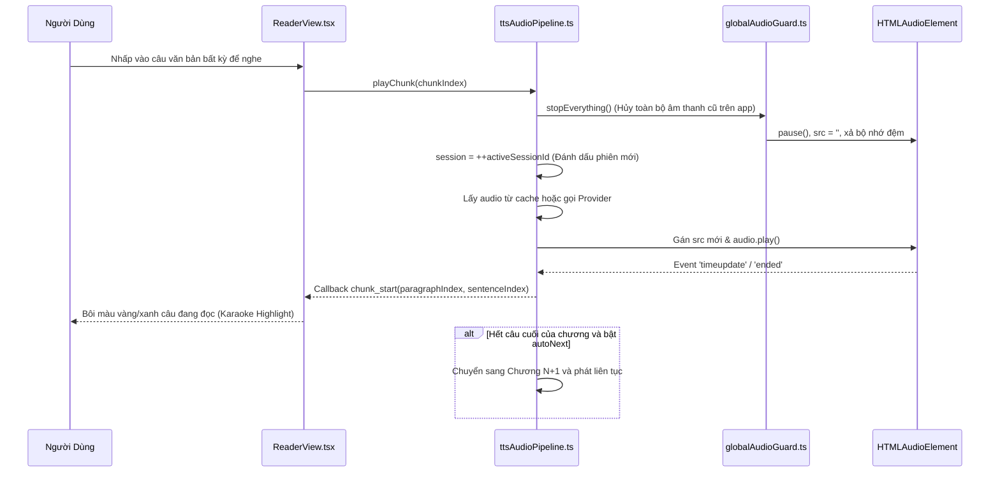
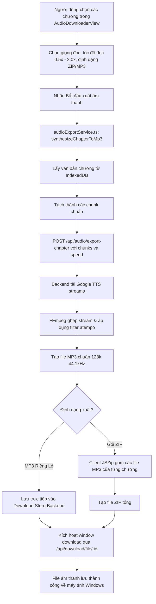

# Sơ Đồ Luồng Dữ Liệu Nghiệp Vụ — Lbook

> **Phạm vi**: Mô tả chi tiết 4 luồng dữ liệu cốt lõi của Lbook: Nạp & phân tích tài liệu, Phát âm thanh & tua câu, Xuất âm thanh hàng loạt, Đồng bộ tiến độ & lưu trữ.

---

## 1. Luồng 1: Nạp & Phân Tích Sách (Import & Document Processing)

Hỗ trợ kéo thả hoặc chọn tệp `.txt`, `.epub`, `.pgp`, `.zip` từ máy tính.

```mermaid
flowchart TD
    A[Người dùng nạp tệp TXT / EPUB] --> B{Kiểm tra phần mở rộng}
    B -->|.txt| C[services/txtParser.ts]
    B -->|.epub| D[services/epubParser.ts]
    B -->|.pgp / .gpg| E[Giải mã OpenPGP client-side] --> C

    D -->|JSZip giải nén container.xml & OPF| F[Trích xuất danh sách chương HTML & Bìa sách]
    F --> G[Làm sạch thẻ HTML & Chuẩn hóa Unicode]

    C -->|Auto-detect UTF-8 / Windows-1258| H[Regex Tiếng Việt: Chương|Hồi|Tiết|Quyển]
    H --> I[services/sentenceSplitter.ts]

    I -->|Tách đoạn & câu, bảo vệ từ viết tắt ThS/PGS| J[services/chunker.ts]
    G --> I

    J -->|Gom câu thành chunk ~240 ký tự| K[Tạo cấu trúc Book & Chapter[]]
    K --> L[Lưu vào IndexedDB storytts_db_v1]
    L --> M[Cập nhật state books trong App.tsx]
    M --> N[Hiển thị sách trong LibraryView]
```

---

## 2. Luồng 2: Phát Âm Thanh Realtime & Tua Câu (TTS Playback & Seek)

Cơ chế độc quyền sử dụng `GlobalAudioGuard` để ngăn ngừa triệt để lỗi nói đè hoặc phát lặp âm thanh.



---

## 3. Luồng 3: Xuất Âm Thanh MP3 / ZIP Hàng Loạt (Audio Downloader)



---

## 4. Luồng 4: Lưu Trữ & Phục Hồi Dữ Liệu (Hybrid Storage Engine)

- **IndexedDB (`StoryTTS_IndexedDB_v2`)**: Chứa 2 object store chính: `books` (metadata) và `chapters` (nội dung chi tiết sách). Dung lượng không giới hạn, không bao giờ bị nghẽn quota 5MB.
- **In-Memory Cache (`memoryCache`)**: Lưu giữ mảng `books` và `chapters` đang mở trong RAM để đọc và render 60 FPS không có độ trễ I/O.
- **LocalStorage**: Lưu trữ cấu hình giao diện `lbook_settings`, từ điển phát âm `lbook_dictionaries`, dấu trang `lbook_bookmarks`, tiến trình đọc `lbook_progress` và migration token `lbook_library_cleaned_v6`.
- **Dọn dẹp thư viện an toàn (`StorageService.deleteAllBooks()`)**: Khi người dùng nhấn nút dọn dẹp trong Cài đặt, hệ thống chỉ xóa các store `books` và `chapters` trong IndexedDB và lịch sử đọc, **giữ nguyên 100% cấu hình giao diện, giọng đọc và phông chữ**.
