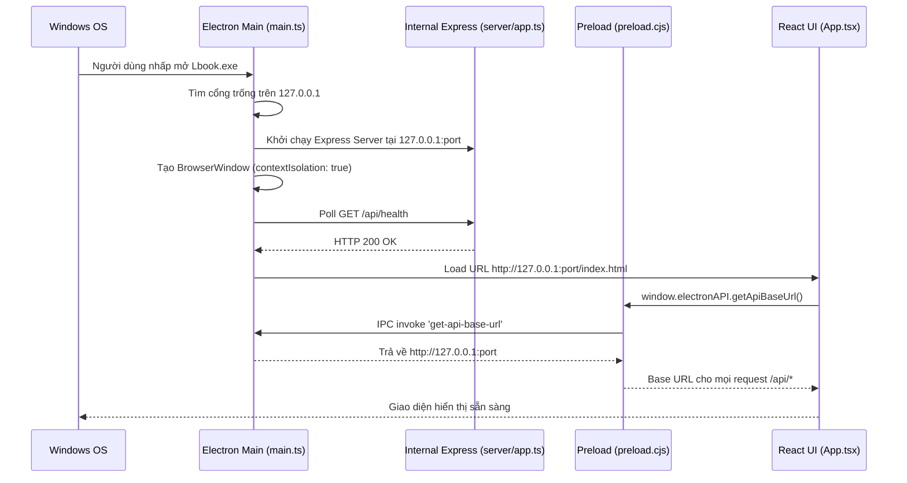

# Kiến Trúc Ứng Dụng Windows Desktop (Electron) — Lbook

> **Phạm vi**: Cấu trúc Electron Main Process (`electron/main.ts`), Preload Script (`electron/preload.cjs`), IPC Bridge, mô hình bảo mật và quy trình đóng gói Windows Executable (.EXE / .ZIP).

---

## 1. Nguyên lý vận hành Desktop của Lbook

Lbook hoạt động trên Windows như một ứng dụng độc lập hoàn chỉnh không cần kết nối Internet bắt buộc (vẫn đọc được sách offline qua giọng SAPI và file đã lưu).

- **Main Process (`electron/main.ts`)**:
  1. Khi app khởi động (`app.whenReady()`), main process tự động tìm một cổng TCP khả dụng trên loopback (thử cổng 3000 hoặc ngẫu nhiên từ 38240+).
  2. Khởi chạy máy chủ Express nội bộ lắng nghe nghiêm ngặt tại `127.0.0.1`.
  3. Mở cửa sổ `BrowserWindow` với kích thước mặc định 1280x800.
  4. Đợi health check của backend tại `http://127.0.0.1:{port}/api/health` trả về HTTP 200 trước khi tải giao diện.
  5. Đóng máy chủ sạch sẽ (`cleanupBackend()`) khi ứng dụng tắt (`before-quit`, `window-all-closed`) để ngăn chặn việc để lại tiến trình rác trong Task Manager.

---

## 2. Mô hình bảo mật IPC & Preload (`electron/preload.cjs`)

Ứng dụng tuân thủ nghiêm ngặt các tiêu chuẩn bảo mật hiện đại nhất của Electron:
- `nodeIntegration: false`: Ngăn trang web thực thi mã Node.js tùy tiện.
- `contextIsolation: true`: Cách ly tuyệt đối vùng nhớ JavaScript giữa trang web và Electron internals.
- `sandbox: true`: Kích hoạt Chromium sandbox cho renderer process.

Preload script chỉ mở đúng các hàm an toàn thông qua `contextBridge`:

```javascript
contextBridge.exposeInMainWorld('electronAPI', {
  getApiBaseUrl: () => ipcRenderer.invoke('get-api-base-url'),
  getVersion: () => ipcRenderer.invoke('get-app-version'),
  minimize: () => ipcRenderer.send('window-minimize'),
  maximize: () => ipcRenderer.send('window-maximize'),
  close: () => ipcRenderer.send('window-close'),
});
```

---

## 3. Quy trình đóng gói Windows (`electron-builder.json`)

Cấu hình đóng gói được định nghĩa trong `electron-builder.json`:
- **App ID**: `com.lbook.desktop`
- **Tên sản phẩm**: `Lbook`
- **Định dạng đầu ra**:
  1. **NSIS Installer**: `Lbook-Setup.exe` (Hỗ trợ cài đặt một click, tạo shortcut màn hình và Start Menu).
  2. **Portable ZIP**: `Lbook-1.0.0-win.zip` (Giải nén là chạy ngay không cần cài đặt).
- **Thư mục đầu ra**: `release/` (Đã được thêm vào `.gitignore` để không làm nặng kho lưu trữ Git và không bị GitHub chặn khi đẩy mã nguồn).

### Các lệnh đóng gói đã xác minh:
```bash
# 1. Biên dịch TypeScript frontend và Electron main
npm run build:all

# 2. Đóng gói đầy đủ cả NSIS Installer và Portable
npm run pack:win

# 3. Đóng gói riêng bản Portable
npm run pack:portable
```

---

## 4. Sơ đồ tương tác giữa Main, Preload và Renderer


