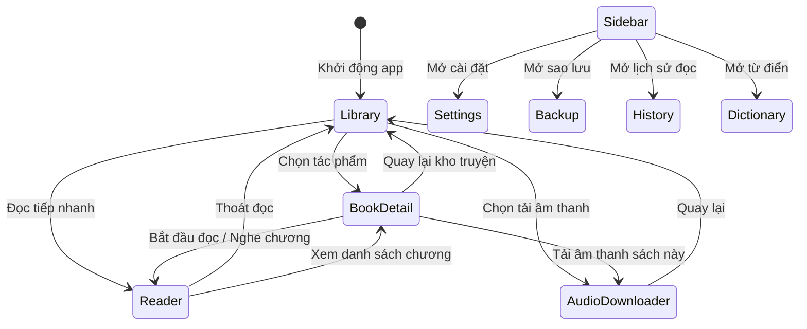

# Kiến Trúc Frontend & Giao Diện Người Dùng — Lbook

> **Phạm vi**: Cấu trúc ứng dụng React 19 SPA, quản lý trạng thái tại `src/App.tsx`, hệ thống design token Glassmorphism và điều hướng màn hình.

---

## 1. Công nghệ & Nguyên lý cốt lõi

- **Framework**: React 19 (`react`, `react-dom`) với functional components và React Hooks.
- **Styling**: Tailwind CSS v4 (`@import "tailwindcss";` trong `src/index.css`) kết hợp biến CSS tùy biến chuẩn Fluent Glass.
- **Biểu tượng**: `lucide-react` (phiên bản ổn định `^0.546.0`).
- **Hoạt họa**: `motion` (`^12.23.24`) cho chuyển cảnh mượt mà.
- **Không dùng React Router**: Toàn bộ điều hướng là một máy trạng thái (View State Machine) điều phối tập trung tại `src/App.tsx`, giúp ứng dụng chạy ổn định tuyệt đối trong cả môi trường file cục bộ của Electron (`file://`) lẫn máy chủ Web (`http://`).

---

## 2. Máy trạng thái điều hướng màn hình (View State Machine)

`App.tsx` quản lý biến trạng thái `currentView: 'library' | 'book-detail' | 'reader' | 'audio-download' | 'backup' | 'settings' | 'history' | 'dictionary' | 'benchmark' | 'ai-models'`.

---

## 3. Hệ thống Design Token Glassmorphism & Đổi Theme

Mọi màu sắc, lớp nền và độ trong suốt được khai báo trong `src/index.css` qua các biến CSS ngữ nghĩa. Ứng dụng hỗ trợ 3 chế độ: `light` (Sáng), `dark` (Tối), và `system` (Theo hệ điều hành).

| Nhóm Token | Biến CSS | Ý nghĩa sử dụng |
| :--- | :--- | :--- |
| **Nền Kính Header** | `--glass-bg-header` | Nền mờ cho thanh công cụ phía trên |
| **Nền Kính Panel** | `--glass-bg` | Nền mờ cho các thanh điều khiển và card |
| **Nền Kính Đậm** | `--glass-bg-strong` | Nền cho dialog, dropdown và menu popup |
| **Nền Kính Mềm** | `--glass-bg-soft` | Nền cho nút thứ cấp, hàng danh sách hover |
| **Đường Viền Kính** | `--glass-border` | Viền phản quang mờ tạo hiệu ứng nổi |
| **Màu Chữ Chính** | `--text-primary` | Màu chữ đen sẫm `#070B14` (Light) hoặc trắng `#FFFFFF` (Dark) |
| **Màu Chữ Phụ** | `--text-secondary` | Màu chữ giải thích, phụ đề, thông số |
| **Màu Nhấn Thương Hiệu** | `--accent` | Xanh ngọc lục bảo (`#047857` trên Light, `#10B981` trên Dark) |
| **Nền Nhấn Mềm** | `--accent-soft` | Nền mờ cho các phần tử đang được chọn |

> **Quy tắc quan trọng**: Tuyệt đối **không viết cứng** các class màu tối như `bg-slate-900`, `bg-gray-800`, `text-slate-200` vào các view (như đã rút kinh nghiệm từ lỗi BUG-001). Mọi component phải dùng các biến `var(--...)` để đảm bảo hiển thị hoàn hảo ở cả Light Mode lẫn Dark Mode.

---

## 4. Danh sách các Views chính và File tương ứng

1. **`src/components/LibraryView.tsx`**: Trang kho sách, tìm kiếm, lọc theo thể loại, sắp xếp, nạp file TXT/EPUB/PGP và xóa sách an toàn.
2. **`src/components/BookDetailView.tsx`**: Xem thông tin chi tiết sách, danh sách chương, nút đảo chiều thứ tự chương, xuất file TXT.
3. **`src/components/ReaderView.tsx`**: Trình đọc toàn màn hình với công nghệ bôi màu karaoke realtime theo từng câu, tua tức thì khi nhấn vào chữ.
4. **`src/components/AudioDownloaderView.tsx`**: Tải âm thanh từng chương hoặc hàng loạt, xuất file ZIP / MP3 HQ.
5. **`src/components/SettingsView.tsx`**: Quản lý giao diện, màu nền, phông chữ, giọng đọc mặc định và mục dọn dẹp thư viện an toàn.
6. **`src/components/TtsControlsBar.tsx`**: Thanh điều khiển phát âm thanh cố định ở đáy màn hình khi người dùng duyệt thư viện.
7. **`src/components/VoiceSelectorModal.tsx`**: Modal chọn giọng nói tiếng Việt với tính năng nghe thử không bị trùng âm.
