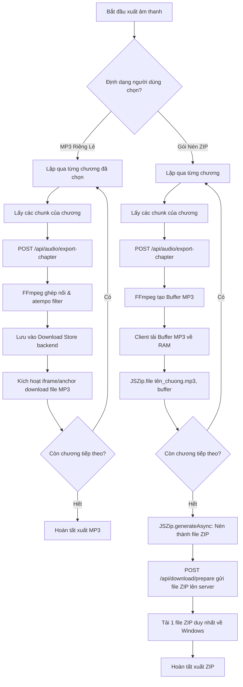

# Đặc Tả Module: Tải & Xuất Âm Thanh Hàng Loạt (MOD-03) — Lbook

> **Phạm vi**: Quy trình xuất âm thanh chương truyện thành file MP3 chất lượng cao hoặc gói nén ZIP, quản lý tiến độ và tích hợp FFmpeg backend.

---

## 1. Thành phần cấu tạo Module

- **`src/services/audioExportService.ts`**: Dịch vụ điều phối xuất âm thanh tại client. Quản lý vòng lặp các chương được chọn, gọi API backend, gom file và nén ZIP qua JSZip.
- **`src/components/AudioDownloaderView.tsx`**: Giao diện người dùng toàn diện cho trang Tải âm thanh. Hỗ trợ chọn sách qua dropdown kính mờ, lọc chương, chọn khoảng chương nhanh (1-10, 1-50, +10 kế tiếp), chọn giọng đọc, tốc độ (0.5x - 2.0x), và theo dõi thanh tiến độ phần trăm.
- **`server/app.ts` (`/api/audio/export-chapter`, `/api/download/*`)**: Backend xử lý ghép audio và cung cấp luồng tải về trực tiếp.

---

## 2. Quy trình xuất âm thanh 2 chế độ



---

## 3. Quản lý trạng thái từng chương (`ChapterExportState`)

Mỗi chương trong danh sách có một trạng thái độc lập:
```typescript
interface ChapterExportState {
  status: 'idle' | 'pending' | 'processing' | 'completed' | 'failed';
  percent: number;       // Tiến độ từ 0% đến 100%
  currentChunk: number;  // Đoạn câu đang xử lý
  totalChunks: number;   // Tổng số đoạn câu của chương
  blob?: Blob;           // Dữ liệu nhị phân audio
  filename?: string;     // Tên file xuất ra
  sizeBytes?: number;    // Dung lượng file (KB/MB)
  downloadUrl?: string;  // Link tải trực tiếp
  error?: string;        // Thông báo lỗi nếu thất bại
}
```

---

## 4. Tính năng nghe thử & Tải độc lập

Người dùng không bắt buộc phải xuất hàng loạt:
- **Nút Nghe Thử (Preview Audio)**: Mỗi chương đã xuất xong đều có nút Play nhỏ gọn để nghe lại trực tiếp trước khi quyết định lưu file.
- **Nút Tải Riêng (Single Chapter Download)**: Bất kỳ chương nào trong danh sách cũng có thể được tải riêng lẻ chỉ với 1 click vào nút MP3 cạnh tên chương.
- **Đặt tên file an toàn**: Tự động chuyển đổi tên tiếng Việt có dấu thành tên file hợp lệ trên Windows (loại bỏ ký tự cấm `\ / : * ? " < > |`).
