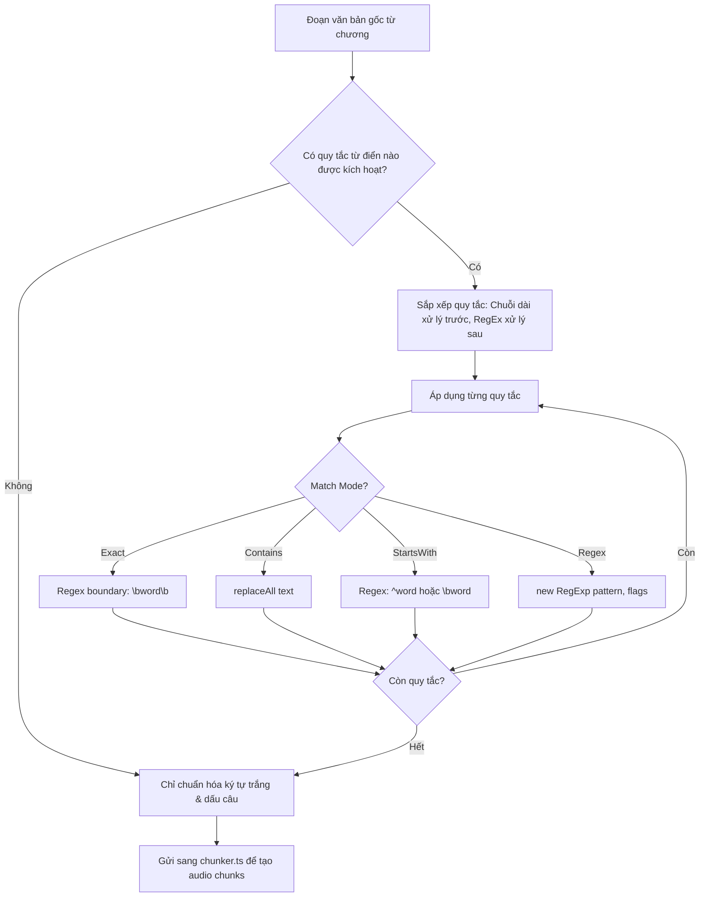

# Đặc Tả Module: Từ Điển Phát Âm (MOD-05) — Lbook

> **Phạm vi**: Quản lý các quy tắc thay thế từ ngữ phát âm sai trong truyện (tên riêng, từ Hán Việt, phiên âm nước ngoài, tiếng lóng) và bàn thử nghiệm phát âm trực tiếp.

---

## 1. Thành phần cấu tạo Module

- **`src/components/DictionaryView.tsx`**: Giao diện quản lý danh sách từ điển, tạo quy tắc mới, lọc tìm kiếm và bàn thử nghiệm phát âm trực tiếp.
- **`src/services/textPreprocessor.ts`**: Bộ tiền xử lý văn bản áp dụng các quy tắc từ điển trước khi gửi chuỗi sang TTS Engine.
- **`src/types/index.ts` (`DictionaryRule`, `Dictionary`)**: Cấu trúc dữ liệu của một quy tắc.

---

## 2. Các chế độ khớp quy tắc (Match Modes)

Một quy tắc (`DictionaryRule`) có thể được cấu hình ở 1 trong 4 chế độ:

| Chế độ Khớp | Mô tả kỹ thuật | Ví dụ văn bản gốc | Thay thế thành |
| :--- | :--- | :--- | :--- |
| **Exact (Chính xác)** | Chỉ thay thế khi từ đứng độc lập (có ranh giới từ `\b`) | `AD` (trong game) | `Ây Đi` |
| **Contains (Chứa)** | Thay thế chuỗi con ở bất kỳ đâu trong từ | `CV` | `Chuyển Văn` |
| **StartsWith (Bắt đầu bằng)** | Khớp tiền tố của từ | `Mc` (trong Mc Donald) | `Mác` |
| **Regex (Biểu thức chính quy)**| Khớp theo mẫu RegEx nâng cao | `Lvl\.?\s*(\d+)` | `Cấp độ $1` |

---

## 3. Quy trình Tiền xử lý Văn bản (`textPreprocessor.ts`)

---

## 4. Bàn thử nghiệm phát âm trực tiếp (Live Test Bench)

Ngay trong `DictionaryView.tsx`, Lbook cung cấp một khu vực thử nghiệm tương tác:
1. Người dùng nhập câu kiểm tra (ví dụ: *"Hắn là một NPC cấp 99"*).
2. Hệ thống hiển thị câu sau khi đã được tiền xử lý (ví dụ: *"Hắn là một En Pi Xi cấp 99"*).
3. Nhấn nút **Nghe thử (Audio Audition)** để kích hoạt TTS phát ngay câu đó, giúp người dùng đánh giá độ tự nhiên của quy tắc trước khi áp dụng cho toàn bộ cuốn sách.

---

## 5. Lưu trữ & Xuất/Nhập Từ Điển

- Các quy tắc từ điển được lưu trữ tự động trong `LocalStorage` dưới khóa `lbook_dictionaries`.
- Khi người dùng xuất gói sao lưu `.storytts` qua module `BackupRestoreView`, toàn bộ từ điển phát âm được đóng gói kèm theo, giúp đồng bộ hóa liền mạch sang máy tính khác.
