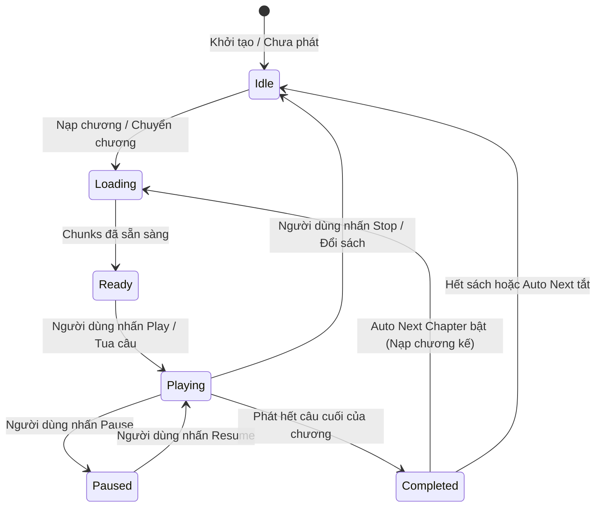

# Đặc Tả Module: TTS Pipeline & Audio Guard (MOD-01) — Lbook

> **Phạm vi**: Quản lý hàng đợi phát âm thanh, state machine, cơ chế tải trước (prefetch), Master Mutex chống trùng tiếng, và tích hợp các nhà cung cấp giọng đọc.

---

## 1. Thành phần cấu tạo Module

Các tệp thuộc module nằm tại `src/services/tts/`:
- **`ttsAudioPipeline.ts`**: Nhạc trưởng điều phối phát âm thanh của truyện. Quản lý danh sách chunk, chuyển câu, tua câu, tự động sang chương tiếp theo.
- **`globalAudioGuard.ts`**: **Master Mutex** duy nhất cho toàn bộ ứng dụng. Đảm bảo mọi âm thanh cũ bị ngắt ngay lập tức khi âm thanh mới kích hoạt.
- **`audioPreviewManager.ts`**: Bộ quản lý nghe thử giọng đọc trong modal cài đặt.
- **`googleTtsProvider.ts`**: Kết nối với backend proxy `/api/tts/google` để lấy giọng đọc tự nhiên.
- **`edgeOnlineTtsProvider.ts`**: Kết nối Microsoft Neural TTS (Nam Minh, Hoài My).
- **`browserTtsProvider.ts`**: Sử dụng Web Speech Synthesis API sẵn có của hệ điều hành.
- **`offlineAiTtsProvider.ts`**: Khung kiến trúc tích hợp mô hình Piper/VinaTTS ONNX offline.
- **`ttsProvider.ts`**: Interface trừu tượng `ITtsProvider` định nghĩa hợp đồng chuẩn.

---

## 2. State Machine của Playback Pipeline

Pipeline hoạt động dựa trên máy trạng thái hữu hạn (FSM):



---

## 3. Cơ chế Chống Trùng Âm Thanh (GlobalAudioGuard Master Mutex)

### Vấn đề thường gặp trong ứng dụng đọc truyện:
Khi người dùng nhấp tua liên tục qua các câu, hoặc nhấp nghe thử nhiều giọng khác nhau, các tiến trình âm thanh bất đồng bộ (`async`) vẫn tiếp tục tải về và phát, dẫn đến hiện tượng 2-3 giọng đọc đè lên nhau gây khó chịu.

### Giải pháp của Lbook:
1. `GlobalAudioGuard.getInstance().stopEverything()` được gọi trước khi bắt đầu bất kỳ âm thanh mới nào:
   - Dừng toàn bộ các phần tử `HTMLAudioElement` đang đăng ký.
   - Gọi `window.speechSynthesis.cancel()`.
   - Gán `src = ''` và kích hoạt hàm `.load()` để giải phóng buffer của card âm thanh.
   - Tăng biến phiên `epochToken++`.
2. Trong `ttsAudioPipeline.ts`, mỗi phiên phát có một `activeSessionId`. Mọi lệnh `await` lấy audio đều kiểm tra:
   ```typescript
   if (this.currentSessionId !== mySessionId) return; // Đã bị hủy bởi lệnh tua mới!
   ```

---

## 4. Cơ chế Prefetch & Cache khóa tất định

- **Kích thước cửa sổ tải trước (`prefetchWindow`)**: Mặc định là **3 chunks**. Khi chunk `i` đang phát, hệ thống tự động tải ngầm chunk `i+1`, `i+2`, `i+3` về bộ nhớ RAM. Nhờ đó, việc chuyển câu tiếp theo diễn ra mượt mà với độ trễ 0ms.
- **Khóa Cache Audio tất định**:
  ```typescript
  cacheKey = hash(`${text}__${provider}__${voice}__${rate.toFixed(2)}__${pitch}`);
  ```
  Nếu người dùng thay đổi tốc độ hoặc đổi từ điển phát âm, khóa hash thay đổi, bảo đảm không bao giờ phát lại âm thanh cũ bị sai tốc độ.

---

## 5. Tự động chuyển chương (Continuous Playback)

Khi chunk cuối cùng của chương kết thúc:
1. Pipeline phát sự kiện `chapter_completed`.
2. Nếu cài đặt `settings.autoNextChapter === true`, hệ thống tự động tìm `chapters[currentIndex + 1]`.
3. Gọi hàm `loadChapter()` và tự động phát từ câu đầu tiên của chương mới mà người dùng không cần chạm vào màn hình.
